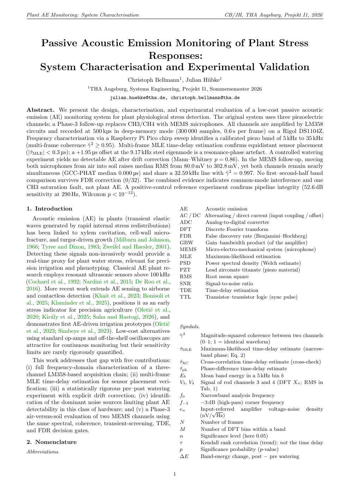
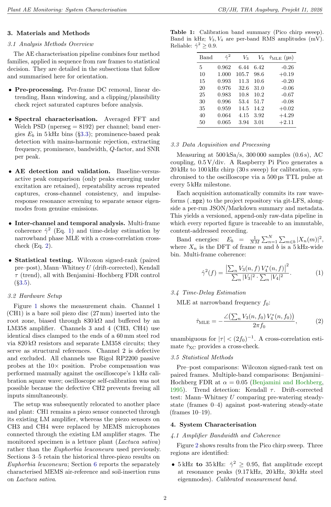
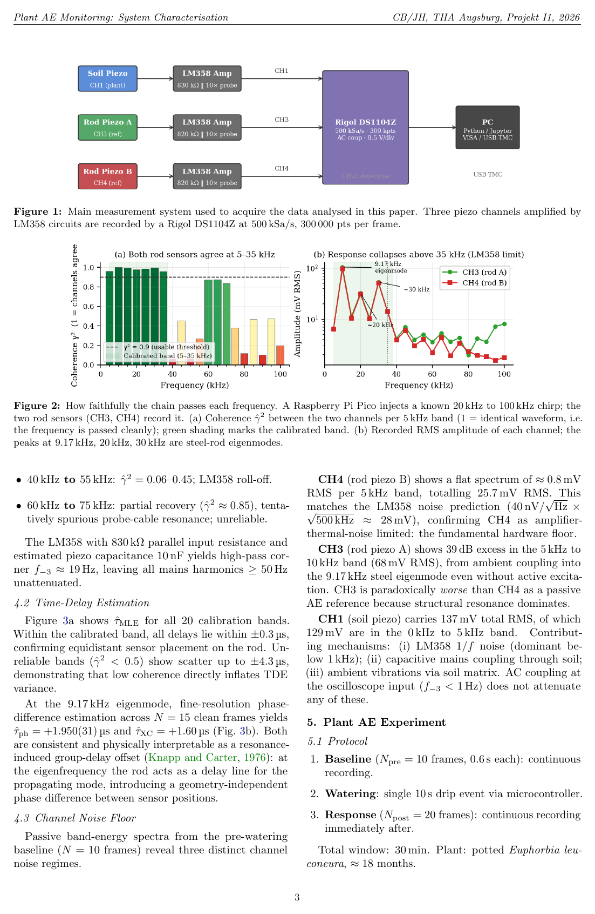
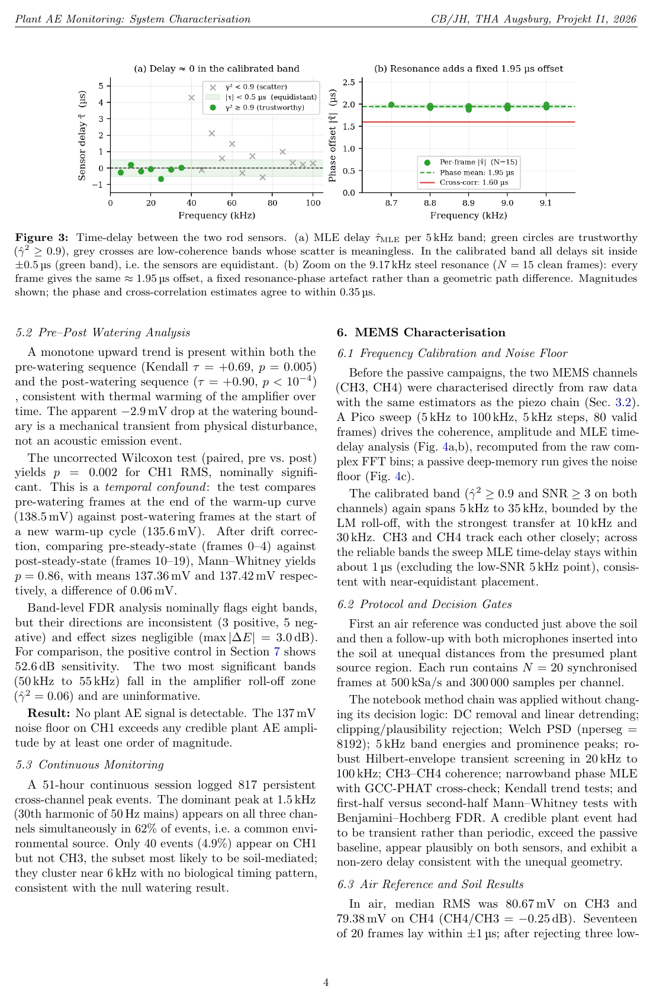
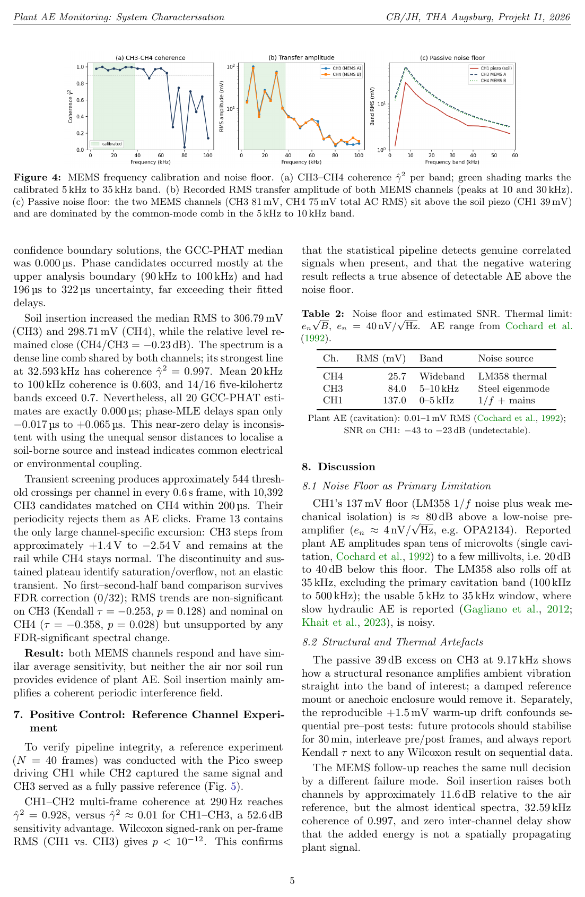
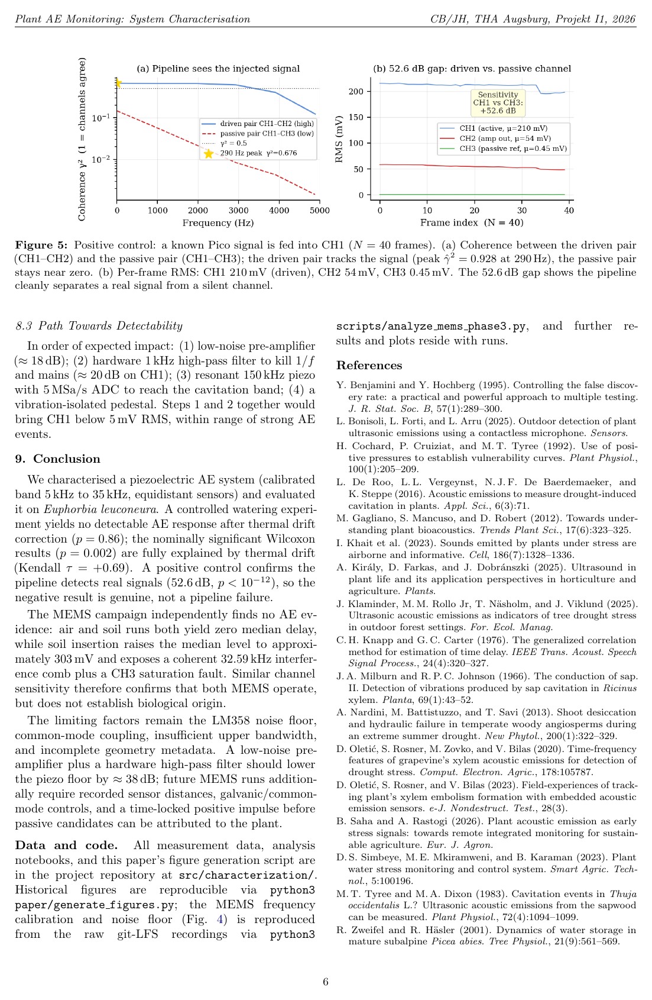

# Passive Acoustic Monitoring of Plant Stress Responses

## Paper

[**Passive Acoustic Emission Monitoring of Plant Stress Responses: System Characterisation and Experimental Validation**](https://github.com/ChristophBellmann/THA_Passive-Acoustic-Emission-Monitoring-of-Plant-Stress-Responses/blob/main/paper/Passive_Acoustic_Emission_Monitoring_of_Plant_Stress_Responses.pdf) – C. Bellmann, J. Hübke, THA Augsburg, Projekt I1, 2026.


Paper (PDF)


**Repository:** [ChristophBellmann/THA_Passive-Acoustic-Emission-Monitoring-of-Plant-Stress-Responses](https://github.com/ChristophBellmann/THA_Passive-Acoustic-Emission-Monitoring-of-Plant-Stress-Responses) – measurement software, data, notebooks and paper sources.

A research and engineering project investigating whether plant-related acoustic emissions can be measured non-invasively and used as feedback for a future **Plant-in-the-Loop** control system.

The project combines sensor development, oscilloscope-based acquisition, reproducible signal processing, artifact discrimination and controlled watering experiments.

## Research question

The long-term objective is to investigate acoustic plant emissions as a real-time feedback signal in controlled-environment agriculture. The work therefore focuses not only on detecting spectral features, but on distinguishing plausible plant-related signals from electromagnetic, structural and environmental artifacts.

## Current approach

The contact-based measurement setup uses piezoelectric sensing around the plant and root zone together with reference channels. Acquisition and analysis are automated in Python/Jupyter and designed for long-running experiments.

The repository documents both promising observations and rejected candidates. This is important: a spectral peak is not treated as a biological signal until competing explanations have been investigated.

Continue with [Research Concept](research-concept.md), [Measurement Setup](measurement-setup.md), [Signal Processing](signal-processing.md), [Experiments & Findings](experiments-and-findings.md), [Artifact Discrimination](artifact-discrimination.md), [Plant-in-the-Loop](plant-in-the-loop.md), and [Reproducibility & Limitations](reproducibility-and-limitations.md).

---

**Renewable Energy Design**  
Engineering · Measurement · Signal Processing · Automation
